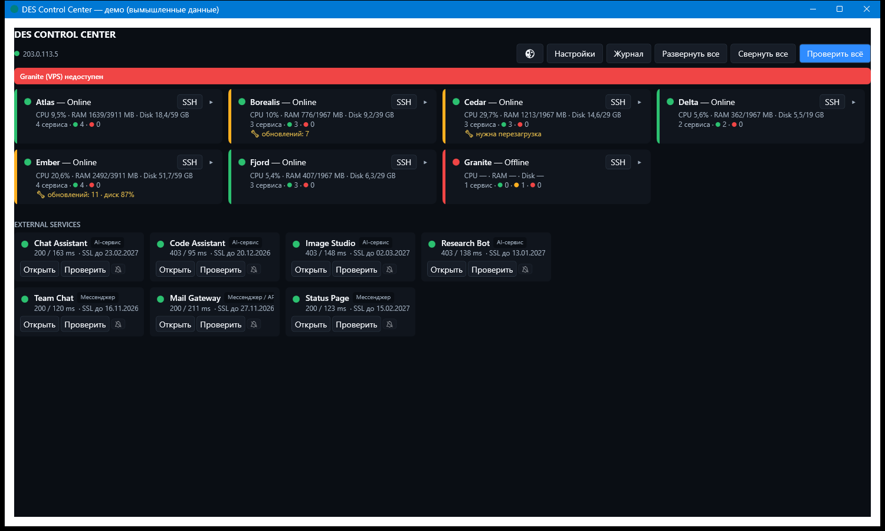
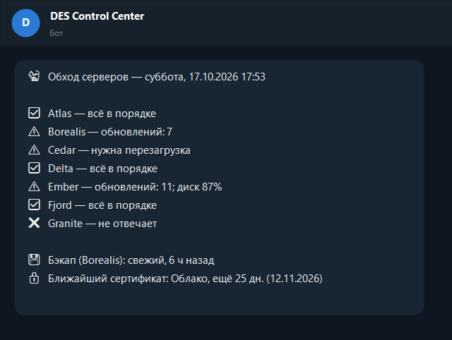

# DES Control Center

Настольное приложение для Windows на C# / WPF / .NET 8: единая панель наблюдения за личной инфраструктурой из 7 VPS и управления службами. Исходный проект закрыт.

## Рабочие сценарии

- Обзор состояния серверов, CPU, памяти, диска, служб и внешних сервисов.
- Просмотр журналов и запуск, остановка или перезапуск службы с подтверждением пользователя.
- Журнал событий, значок состояния в системном трее, светлая и тёмная темы.
- Ежедневная сводка и сообщения о проблемах в Telegram.

Для внешних сервисов индикатор показывает доступность: полученный HTTP-ответ, включая 403, считается признаком доступного сервера. Это не утверждение об успешной авторизации или работоспособности всех функций сервиса.

## Демонстрационные материалы

Все имена, показатели и инфраструктура в примерах вымышлены. Адрес из документационного диапазона на обзорном изображении служит примером и не является адресом рабочей системы.

Обзор показывает интерфейс приложения в демо-режиме. Демо-данные подставляются в интерфейс приложения; изображение не является свидетельством текущего состояния реальных серверов.

Вторая картинка — иллюстрация сообщения, а не скриншот переписки в Telegram. Текст сформирован кодом отчёта на демо-данных. [Текстовый пример](des-control-center-report.txt).

## Моя роль и роль AI-агента

Я поставил задачу, определял состав мониторинга и правила оповещений, принимал решения по интерфейсу и подтверждению действий. Проверяю результат на своей инфраструктуре и использую приложение в повседневной работе.

Claude Code по моим заданиям подготовил код приложения, техническую архитектуру, мониторы, отчёты, тесты и демонстрационный режим. Инфраструктурные изменения выполнялись по моим заданиям и с моим одобрением.

Этот кейс показывает постановку прикладной задачи, организацию разработки с AI-агентом, приёмку и эксплуатацию. Он не заявляет, что весь код написан мной вручную.

[Вернуться к портфолио](../README.md)
