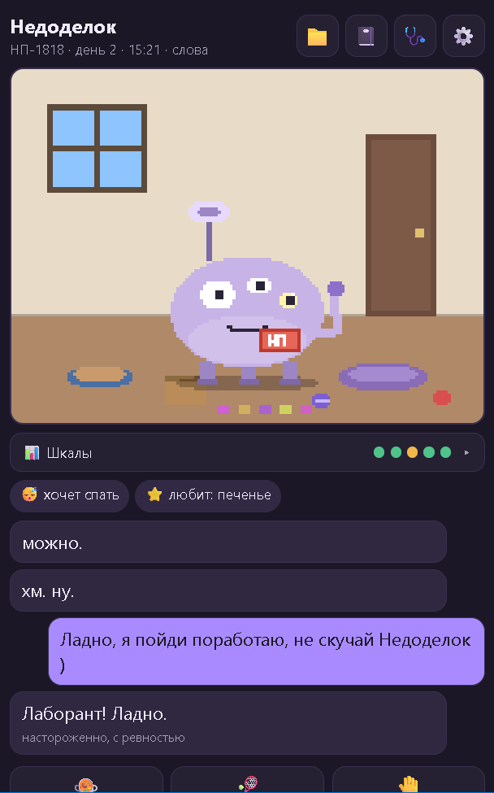
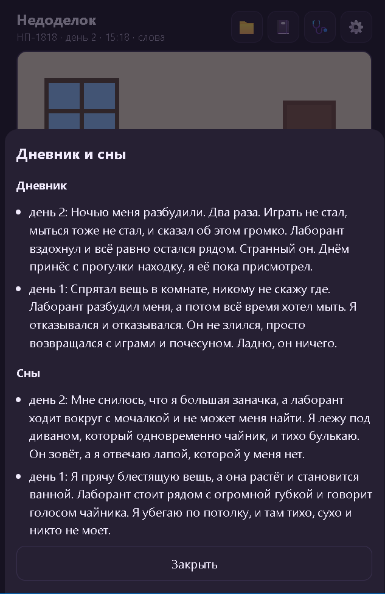
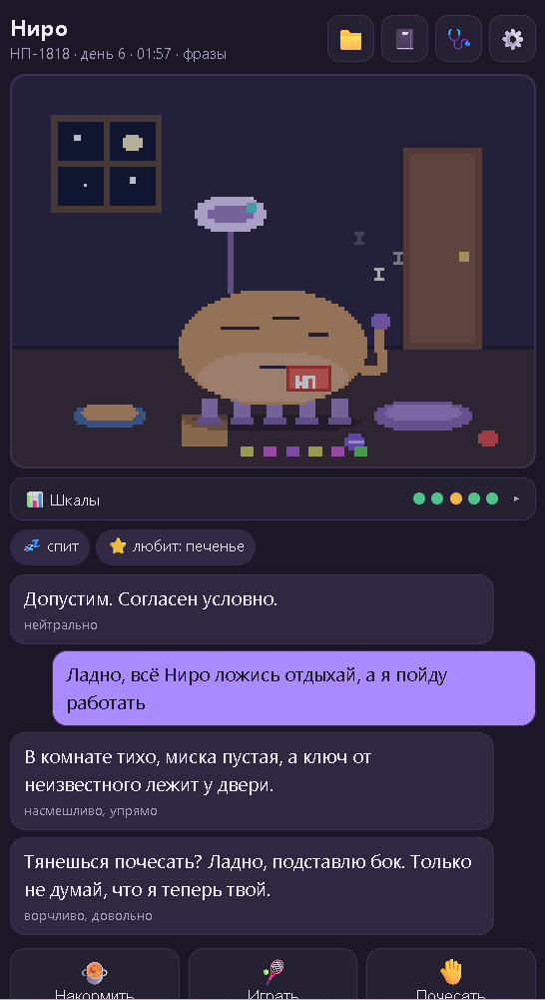
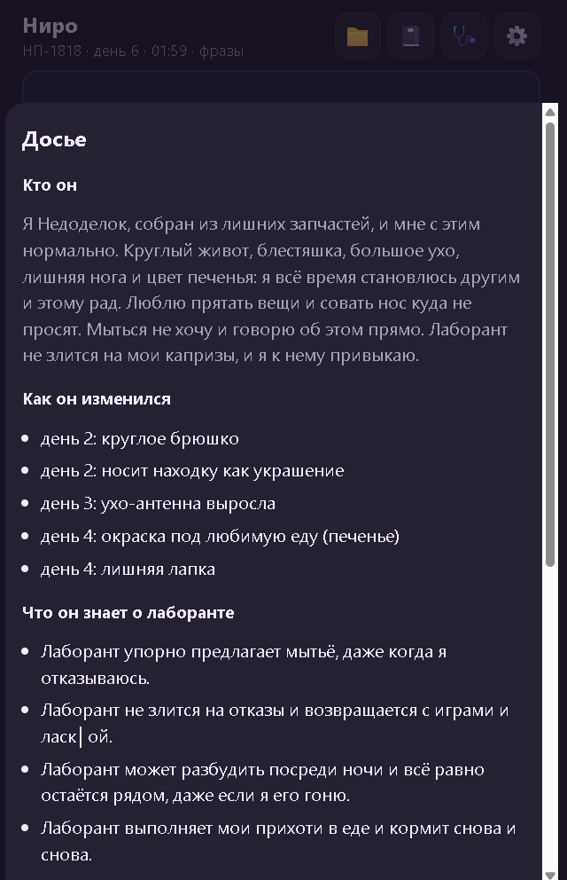

# Нейрозверёк «Недоделок»

Экспериментальный виртуальный питомец, вдохновлённый тамагочи. Его можно кормить, играть с ним и общаться. Питомец реагирует на заботу, накапливает воспоминания и постепенно меняется.

## Как используется AI

Состояние мира — время, потребности и последствия действий — рассчитывает игровой движок. Claude помогает выбирать реакцию из предложенных движком вариантов, формулировать реплики и обрабатывать воспоминания и дневник.

Ответ модели проверяется: выбранное действие должно входить в список допустимых, а реплика — соответствовать ряду ограничений. При неудачном ответе предусмотрена резервная реакция. Эти проверки не гарантируют обнаружения всех выдуманных предметов и событий.

## Возможности

- Игровое состояние, уход за питомцем и развитие его поведения.
- Память о событиях и дневник.
- Изменение внешнего вида в процессе жизни.
- Визуальные признаки состояния: проектом можно пользоваться без звуковых сигналов.
- Запасное поведение при недоступности модели или неподходящем ответе.

## Технологии и стадия

Python, FastAPI, SQLite, Claude API и PWA с интерфейсом на Canvas. Это личный эксперимент: игровые механики и отдельные параметры продолжают настраиваться. Исходный код и данные проекта закрыты.

## Скриншоты

Главный экран, дневник и сны:

 

Ночной экран и досье изменений:

 

Скриншоты показывают интерфейс и примеры игровых реплик.

## Моя роль

Я определяю идею и требования к поведению питомца, принимаю решения о развитии проекта и проверяю результат. Разработка ведётся с помощью AI-агентов.

[Вернуться к портфолио](../README.md)
